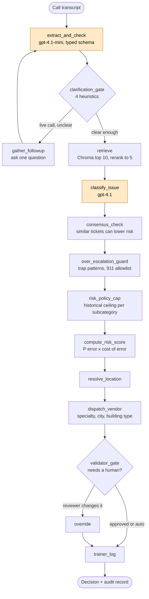

# Facilities Dispatch Agent

A human-in-the-loop voice agent that triages facilities-maintenance calls: it classifies the issue, sets a risk level, resolves the building and floor, picks a vendor, and decides whether to auto-dispatch, ask one clarifying question, or hand the call to a person.

Built with LangGraph, OpenAI (`gpt-4.1-mini` for extraction, `gpt-4.1` for classification), a Chroma index over 10,000 historical tickets, and an ElevenLabs speech front end.

**Dev-set composite score: 88.66 / 100** (200 labeled calls, zero false emergency dispatches). Details under [Results](#results).

## Problem

A commercial real-estate operator fields roughly 10,000 facilities calls a day. Most are routine (a blocked sink, a flickering light, a badge that won't scan), but every one of them reaches a human operator. The goal is to resolve the routine calls automatically and escalate only the ones that need judgment.

Two mistakes cost far more than the others. Sending emergency services to burnt popcorn wastes a public resource, and filing a real gas leak as an odor complaint puts people at risk. The design is built around those two errors.

The scenario and data come from a course project modelled on CBRE's call intake: 52 buildings, 32 vendors, 250 known callers, 10,000 past tickets, and a 10-category, 36-subcategory taxonomy.

## How it works

Two LLM calls do the language work. Everything after classification is deterministic code that checks the model's answer before anything is dispatched.



The orange nodes call an LLM. The rest are plain Python.

| Stage | What it does | Code |
|---|---|---|
| Extract | Pulls issue, system, severity, building and floor into a Pydantic schema, with flags for whether the description is specific enough. | [`agent/intake.py`](agent/intake.py) |
| Clarification gate | Decides whether to ask a follow-up, using four explicit signals (very short caller, generic opening, caller corrected their floor, floor higher than the building). | [`agent/intake.py`](agent/intake.py) |
| Retrieve and rerank | Finds 10 similar past tickets, then reranks to 5 using building, building type, severity and city. | [`agent/rag_classify.py`](agent/rag_classify.py) |
| Classify | Chooses category, subcategory and risk level from the taxonomy, with the retrieved tickets as context. | [`agent/rag_classify.py`](agent/rag_classify.py) |
| Consensus check | If similar past tickets were lower risk, it lowers the risk level. It never raises it. | [`agent/rag_classify.py`](agent/rag_classify.py) |
| Over-escalation guard | Rewrites known false alarms (burnt food filed as fire, cleaning fumes filed as gas leak) and only allows emergency dispatch for five subcategories. | [`agent/risk.py`](agent/risk.py) |
| Risk cap | Caps the risk level at the highest level that subcategory has historically reached on at least 3% of tickets. | [`agent/risk.py`](agent/risk.py) |
| Risk score | Sends the call to a human when P(error) x Cost(error) passes a threshold, or when risk is HIGH/EMERGENCY, or confidence is under 0.6. | [`agent/risk.py`](agent/risk.py) |
| Dispatch | Picks a vendor by specialty, then city, then building-type certification, then availability, rating and SLA. If nobody qualifies, the call goes to a human. | [`agent/dispatch.py`](agent/dispatch.py) |
| Human review and log | Pauses for a reviewer when flagged, applies their correction, and writes a full audit record for every call. | [`agent/hitl.py`](agent/hitl.py) |

Every check that runs after the model can lower a risk level or add a human review. None of them can raise a risk level or turn on emergency dispatch.

[`docs/architecture_doc.md`](docs/architecture_doc.md) explains each decision, the alternatives considered and the trade-offs.

## Results

Scored on the 200 labeled dev calls with [`evaluation/scoring.py`](evaluation/scoring.py), the scorer supplied with the project.

| Axis | Weight | Score |
|---|---|---|
| Category accuracy | 10% | 98.0% |
| Subcategory accuracy | 15% | 95.0% |
| Risk-level accuracy | 10% | 84.0% |
| Human-review trigger F1 | 15% | 79.7% (precision 0.77, recall 0.83) |
| Clarification F1 | 5% | 68.5% (precision 0.61, recall 0.78) |
| Location fields (building, address, floor) | 10% | 86.5% |
| Vendor match | 10% | 86.0% |
| Auto-resolution of routine calls | 10% | 85.9% (73 of 85) |
| Call summary present | 5% | 100% |
| Trainer log present | 10% | 100% |
| **Composite** | | **88.66** |

On the 16 calls written to bait a false emergency dispatch, the agent dispatched emergency services zero times. The weakest axis is clarification: the agent asks a follow-up more often than the labels say it should.

Changes were kept only when they improved the dev score. For example, wiring historical base-risk priors into the classify prompt added about 4 points, and the deterministic clarification gate brought the composite to 87.72 at the time.

## Voice demo

`web/voice_server.py` puts the same agent behind a phone-style web page. ElevenLabs Scribe transcribes the caller in real time, the agent either asks a follow-up question or closes the call, and ElevenLabs Flash speaks the reply. You can also type turns instead of speaking.

```bash
python web/voice_server.py
# open http://localhost:8000 in Chrome or Edge
```

## Run it

Tested on Python 3.12. Needs an OpenAI API key. The voice demo also needs an ElevenLabs key.

```bash
python3 -m venv .venv && source .venv/bin/activate
pip install -r requirements.txt

# .env at the repo root
echo "OPENAI_API_KEY=sk-..." > .env
echo "ELEVENLABS_API_KEY=..." >> .env   # only for the voice demo

# One-time: embed the 10,000 historical tickets into ./chroma_db
python scripts/build_chroma.py

# Run the agent over the dev set, then score it
python evaluation/run_eval.py --agent agent:classify \
    --eval evaluation/eval_transcripts_dev.json --out predictions.json
python evaluation/scoring.py --predictions predictions.json
```

To call the agent directly:

```python
from agent import classify

prediction = classify(
    turns=[
        {"speaker": "agent", "text": "Maintenance, what's going on?"},
        {"speaker": "caller", "text": "The breakroom sink on Floor 9 won't drain."},
    ],
    caller_phone="+1-415-555-0139",
)
```

## Tests

The deterministic layer (trap patterns, emergency allowlist, risk cap, risk score, vendor selection, location matching) has unit tests that run in under a second and make no API calls.

```bash
pip install -r requirements-dev.txt
pytest
```

## Limitations

- **The false-alarm traps are keyword rules.** For example, a call classified as `fire_smoke` is rewritten to an air-quality issue if the transcript mentions "popcorn", "toast" or "microwave". The rules were written from mistakes seen on the dev set, so they may not hold on new phrasing, and they can misfire: a real fire that involves a microwave would be demoted. Every rewrite is sent to a human reviewer, which limits the damage, and `tests/test_risk_guards.py` records this case as a known failure.
- **What we would do at scale.** Replace the keyword lists with a small classifier trained on the QA audit data and on reviewer overrides collected in the trainer log, keep the emergency allowlist as a hard rule, and measure the false-alarm rate on calls the rules were not written against.
- **Thresholds were tuned on one 200-call dev set.** The risk-score weights, the 0.30 review threshold and the 3% cap threshold are hand-set constants in [`agent/config.py`](agent/config.py), not fitted values.
- **The clarification loop only runs in live calls.** In batch evaluation the agent flags that it would ask a question but cannot ask it.
- **The retrieval index is static.** New buildings or vendors are invisible until `scripts/build_chroma.py` is rerun.
- **Latency is 5 to 15 seconds per call**, dominated by two sequential LLM calls.

## Repository layout

```
agent/         the LangGraph pipeline, one module per stage
docs/          architecture document and the rendered graph
evaluation/    dev and test transcripts, labels, eval harness and scorer
operational/   buildings, vendors, caller profiles, historical tickets, taxonomy
models/        risk policy derived from historical tickets
scripts/       build the Chroma index, fit the risk policy, render the graph
tests/         unit tests for the deterministic layer
web/           voice demo server and front end
```

## Who built what

A two-person project by Rich ([@rwang5412](https://github.com/rwang5412)) and Shahin Sheikh.

- **Rich:** the initial end-to-end pipeline, historical base-risk priors in the classify prompt, the deterministic clarification gate, and the second-pass LLM review of the clarification decision.
- **Shahin:** the historical risk policy and risk cap, RAG retrieval and reranking, the P(error) x Cost(error) review trigger, the reorganisation into the `agent/` package, and the voice server and front end.
